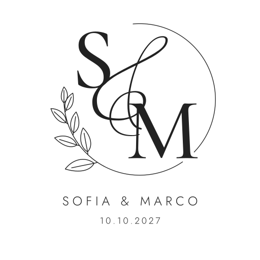
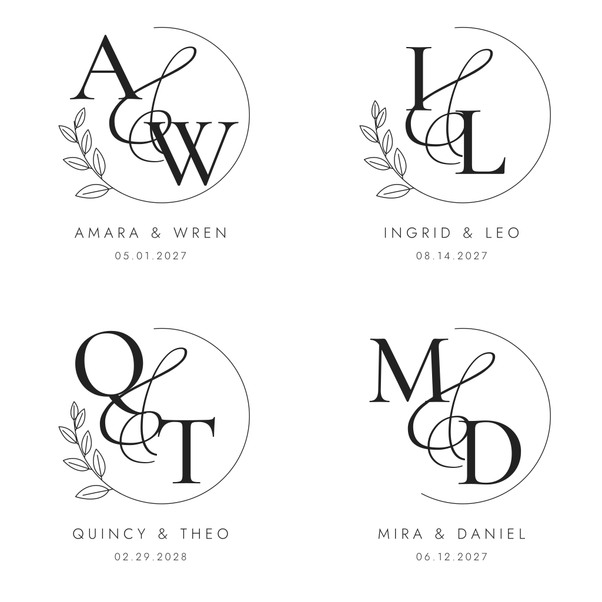
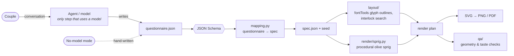
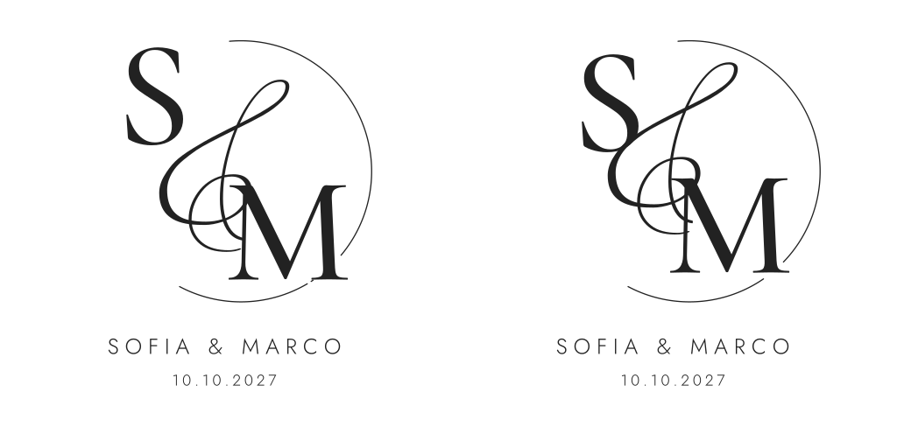
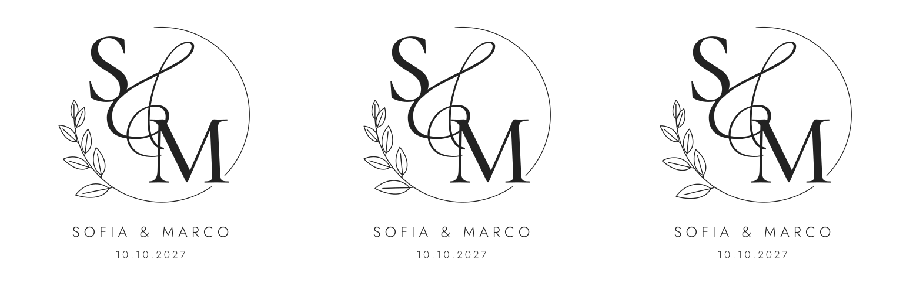

# wedding-visual-generator

A **deterministic** wedding monogram generator, packaged as an agent skill. You answer a
short questionnaire; plain, tested Python does the rest: layout, typography, ornament,
rendering, quality checks. The language model's only job is turning the conversation
into a small JSON file. It never draws.

<p align="center"></p>

- **Same input, same bytes.** A spec plus a seed always renders the identical SVG; tests
  enforce it. The seed is the only source of variation.
- **No image-generation API, no API key.** The questionnaire step runs on whatever agent
  you already use (Claude Code, Codex, …), or on no model at all: write the JSON by hand.
- **Taste is encoded as checks, not vibes.** Design judgments that came out of review
  ("the ampersand shouldn't look like a blade", "the three glyphs must interlock, not float")
  are measurable rules in `qa/`, so a future font or template change can't quietly regress them.

## Gallery

All rendered by `scripts/make_readme_images.py` from placeholder names. The bottom-right
one has the olive sprig turned off.

<p align="center"></p>

## Quickstart

```bash
git clone <this repo> && cd wedding-visual-generator
python3 -m venv .venv && source .venv/bin/activate && pip install -e '.[dev]'
```

**As a skill (Claude Code).** Open Claude Code in this repo and run `/wedding-monogram`,
or just ask for a wedding logo. The skill
([`skills/wedding-monogram/SKILL.md`](skills/wedding-monogram/SKILL.md)) asks for the
names, date, where the logo will be used, and whether to add the olive sprig. It then
writes `private/<couple>/questionnaire.json` and runs the CLI below. Other agents (Codex,
Cursor, …) get the same workflow from [`AGENTS.md`](AGENTS.md).

**As a plain CLI, no model involved:**

```bash
cat > questionnaire.json <<'EOF'
{
  "partner_a_name": { "latin": "Sofia Lin" },
  "partner_b_name": { "latin": "Marco Rossi" },
  "date": "2027-10-10",
  "design_basis": "names"
}
EOF
python -m wedding_visual questionnaire-to-spec questionnaire.json --seed 0 -o spec.json
python -m wedding_visual render spec.json -o logo.svg      # add --png logo.png if resvg/rsvg-convert/inkscape is installed
python -m wedding_visual qa spec.json
```

## How it works



| Stage | Module | What it does |
|---|---|---|
| Validate | `schema/*.schema.json`, `validation.py` | Rejects malformed answers before anything runs. |
| Map | `mapping.py` | Questionnaire → spec with fixed rules (defaults: template `monogram-v2`, sprig on, usage = invitation + e-invite + backdrop). |
| Lay out | `layout/glyphs.py`, `layout/diagonal.py`, `ink.py` | Reads real glyph outlines with fontTools; searches for the `&` placement that interlocks with both initials. |
| Ornament | `render/arc.py`, `render/sprig.py` | Hairline arc that breaks where it meets ink; a parametric olive sprig whose leaves vary with the seed. |
| Render | `render/plan.py`, `render/svg.py`, `render/export.py` | A structured render plan is serialized to SVG (all text as outlines, no font needed to view it). PNG/PDF go through whichever of resvg / rsvg-convert / inkscape is installed. |
| Check | `qa/checks.py`, `qa/shape.py` | Findings with severity (FAIL / WARN / INFO), re-measured from the rendered paths, independent of the layout code. |

Templates (`templates/*.json`) hold **parameters only**: layout type, fonts, ratios,
motif type. They never hold geometry taken from anyone's artwork.

## Design judgment, encoded

Two pieces of review feedback became measurable rules, enforced both in the layout and
again in QA.

**1. The `&` must interlock with both initials, not float between them.** At fixed
positions, the `&` shared zero ink with the "S" in *Sofia & Marco* (left). The layout now
searches small whole-step moves for the least movement that gives each initial between
3% and 10% of the ampersand's ink in contact (right). QA re-measures this from the
rendered paths and raises `detached-connector` if it fails. The pull is capped: forcing
some pairs (P & J) to touch crams them into a knot. Those get an honest WARN instead.

<p align="center"></p>

**2. A wedding flourish should curl, not cut.** The first script font's `&` was dominated
by one long straight diagonal and read as a fencing blade. `qa/shape.py` measures the
longest straight diagonal run of an outline relative to its height. Across 20
OFL-licensed script ampersands the rejected one scored 0.64 and every other font
≤ 0.55, so anything above 0.55 now raises `blade-like-connector`. The chosen font,
Monsieur La Doulaise, has a looping, treble-clef-like `&`.

**Seeds give sibling variants.** The seed jitters only the sprig's leaf angles and
lengths: a gentle variation of one design, never a different design. Same seed, same
bytes.

<p align="center"></p>

## Quality checks

| Code | Level | Catches |
|---|---|---|
| `overflow` | FAIL | Anything drawn outside the canvas. |
| `motif-overlap` | FAIL | Arc or ring running through a letter (point-in-outline test, not bounding boxes). |
| `ornament-overlap` | FAIL | Sprig running through a letter. |
| `low-contrast` / `borderline-contrast` | FAIL / WARN | Ink vs background below WCAG 3:1 / 4.5:1. |
| `insufficient-bleed-margin` | WARN | Less than 2% margin when a print use is targeted. |
| `thin-motif-stroke` | WARN | Hairlines that vanish when scaled to a 32 px favicon. |
| `blade-like-connector` | WARN | A connector `&` that reads as a blade (see above). |
| `detached-connector` | WARN | A connector that doesn't interlock with an initial (see above). |
| `no-background` | INFO | Transparent output: contrast can only be judged once it's placed. |

## Evaluation

`eval/cases/` holds 10 fictional couples chosen to stress the layout: descenders (J, Q,
Y), a struck-through Ø, an accented initial, a same-initial pair, every usage target, and
one case with no style answers at all. Each runs the whole pipeline without intervention:
`python -m wedding_visual eval`.

| Case | Names | FAIL | WARN | INFO | WARN codes |
|---|---|---|---|---|---|
| 01-mira-daniel | Mira Chen & Daniel Osei | 0 | 1 | 1 | thin-motif-stroke |
| 02-priya-jonas | Priya Nair & Jonas Falk | 0 | 3 | 1 | detached-connector ×2, thin-motif-stroke |
| 03-yusuf-elena | Yusuf Demir & Elena Petrova | 0 | 1 | 1 | thin-motif-stroke |
| 04-quincy-wren | Quincy Adebayo & Wren Sato | 0 | 1 | 1 | thin-motif-stroke |
| 05-amara-aiden | Amara Osei & Aiden Cole | 0 | 1 | 1 | thin-motif-stroke |
| 06-oyvind-noor | Øyvind Berg & Noor Haddad | 0 | 1 | 1 | thin-motif-stroke |
| 07-jing-marcus | Jing Lu & Marcus Villanueva | 0 | 1 | 1 | thin-motif-stroke |
| 08-fatima-lucas | Fatima Zahra & Lucas Meyer | 0 | 1 | 1 | thin-motif-stroke |
| 09-grace-henrik | Grace Kim & Henrik Voss | 0 | 1 | 1 | thin-motif-stroke |
| 10-ibrahim-chloe | Ibrahim Osei & Chloe Dubois | 0 | 1 | 1 | thin-motif-stroke |

**Pass rate: 100% (10/10)**, where a pass means no FAIL. The warnings are real signals,
not noise:
- `thin-motif-stroke` on every case is the template's deliberate hairline arc. It's fine
  on paper and screens, and would disappear on a favicon.
- `detached-connector` on case 02 is the P & J pair described above.

This eval set has already caught one real bug: an earlier template's ring overlapped the
letters it encircled, which the unit tests hadn't exercised.

## Cost comparison

Common ways to get an AI-made wedding logo, compared per logo:

| | This repo | Model writes the SVG | Image-generation API |
|---|---|---|---|
| What the model produces | ~300 bytes of questionnaire JSON | The whole SVG. The hero above is 44 KB of path data, on the order of 10k+ output tokens per attempt (estimate). | A raster image |
| Each revision | Edit JSON, re-render locally (~0.2 s, 0 tokens) | Another full generation | Another paid image call |
| Reproducible | Byte-identical, tested | No | No |
| Output | Vector SVG (plus PNG/PDF) | Vector, but hand-drawn letterforms | Raster; needs vectorizing for print |
| Needs | Your existing agent subscription, or nothing | Your existing agent subscription | A separate API key and billing |
| Quality control | Deterministic checks on exact geometry | The model judging its own output | Visual inspection |

## Status

| | |
|---|---|
| Names-based monogram (`monogram-v2`), skill, CLI, QA, eval | ✅ done |
| `monogram-v1` (first geometric template, kept selectable) | ✅ done |
| Photo → silhouette line drawing (`design_basis: "photo"`) | ⏸ not started: a separate skill set, deliberately deferred. The schema already reserves it. |
| Color palettes | ⏸ out of scope for now (monochrome by design) |

## Privacy and copyright

- `private/` and `refs/` are gitignored. Real names, photos, reference images and
  outputs live there and are never committed. Every name in this repo is a placeholder.
- Reference images may inform style answers but are never traced or vectorized. The
  repo has no feature for copying another work's geometry, and templates store
  parameters only.
- The `monogram-v2` style direction came from a reference image the author supplied.
  Only general conventions were taken: diagonal initials, a script ampersand, an open
  arc, a botanical sprig, tracked capitals. Every shape is generated by this code.

## Fonts

Only open-licensed fonts are bundled. Each has its license file next to it, and source
and copyright are in [`fonts/README.md`](fonts/README.md).

| Font | Used for | License |
|---|---|---|
| Cormorant Garamond | `monogram-v2` initials | SIL OFL 1.1 |
| Monsieur La Doulaise | `monogram-v2` ampersand | SIL OFL 1.1 |
| Jost | `monogram-v2` names and date | SIL OFL 1.1 |
| EB Garamond | `monogram-v1` | SIL OFL 1.1 |

## Sources and credits

No third-party code is copied into this repo. These projects (all MIT) shaped its design
and are credited for it. Details are in [`docs/research.md`](docs/research.md).

- [kaankiziltug/logo-design-skill](https://github.com/kaankiziltug/logo-design-skill):
  the checklist-of-findings approach to SVG quality checks, which `qa/` re-implements on
  render plans, and its practice of licensing reference material separately from code.
- [neonwatty/logo-designer-skill](https://github.com/neonwatty/logo-designer-skill): the
  renderer fallback chain for SVG → PNG export.
- [op7418/logo-generator-skill](https://github.com/op7418/logo-generator-skill): pattern
  naming ideas. Its approach (image-generation API) is the right-hand column of the cost
  comparison.

## Development

```bash
python -m pytest -q                     # 119 tests
python -m wedding_visual eval           # evaluation table above
python scripts/make_readme_images.py    # regenerate docs/images/ (deterministic)
```

See [`AGENTS.md`](AGENTS.md) for the repo's rules: determinism, parameters-only
templates, open-licensed fonts, small commits that explain why.
